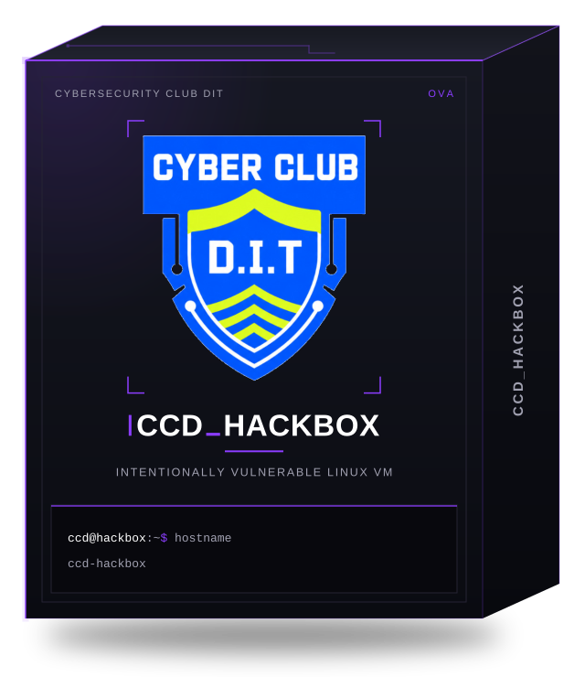

  

  <strong>CYBERSECURITY CLUB DIT</strong>

<h1 align="center">
  
</h1>

  An intentionally vulnerable Linux virtual machine for authorized training.

  
  
  
  

  

## Documentation

- [Overview](#overview)
- [Product](#product)
- [Lab boundaries](#lab-boundaries)
- [Brand](#brand)

## Overview

CCD_HACKBOX is the Cybersecurity Club DIT training appliance. It is one Linux virtual machine, built with known weaknesses so members can study them in a supervised lab.

## Product

The appliance ships as an OVA. Import it into a local hypervisor, keep the network interface on an isolated lab segment, and treat the guest as untrusted.

## Lab boundaries

- Use it only where you have permission to run a vulnerable system.
- Do not attach it to a production network or the public internet.
- Do not aim it at machines, accounts, or data you do not own.

## Brand

The club mark in this repository is the official Cybersecurity Club DIT logo. It is used unchanged. Product color is purple on near-black.

| File | Role |
| --- | --- |
| [assets/ccd-logo.png](assets/ccd-logo.png) | Official mark, original proportions |
| [assets/ccd-logo.jpeg](assets/ccd-logo.jpeg) | Original supplied file |
| [assets/ccd-hackbox-wordmark.svg](assets/ccd-hackbox-wordmark.svg) | CCD_HACKBOX wordmark |
| [assets/ccd-hackbox-ova.svg](assets/ccd-hackbox-ova.svg) | Package illustration |