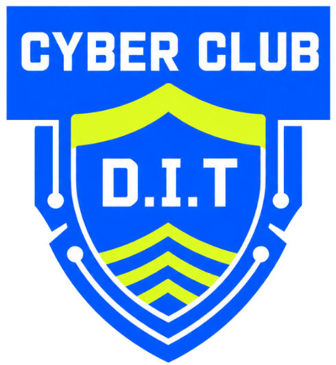

<p align="center">
  
</p>

<p align="center">
  <strong>CYBERSECURITY CLUB DIT</strong>
</p>

<h1 align="center">
  
</h1>

<p align="center">
  An intentionally vulnerable Linux virtual machine for authorized cybersecurity training.
</p>

<p align="center">
  
  
  
  
  
</p>

<p align="center">
  
</p>

---

## Table of Contents

- [Overview](#overview)
- [Project Objectives](#project-objectives)
- [System Architecture](#system-architecture)
- [Learning Modules](#learning-modules)
- [Lab Environment](#lab-environment)
- [Getting Started](#getting-started)
- [Network Configuration](#network-configuration)
- [Repository Structure](#repository-structure)
- [Challenge Framework](#challenge-framework)
- [Security Guidelines](#security-guidelines)
- [Project Roadmap](#project-roadmap)
- [Contributing](#contributing)
- [Disclaimer](#disclaimer)
- [Credits](#credits)

---

## Overview

**CCD_HACKBOX** is an intentionally vulnerable Linux virtual machine developed by Cybersecurity Club DIT for practical cybersecurity education.

The project provides a controlled and isolated environment where students can explore common security weaknesses, understand how vulnerabilities affect Linux systems and services, and practice penetration testing techniques.

Built around Ubuntu Server, the appliance is designed to support hands-on exercises covering network security, web application security, service enumeration, vulnerability assessment, exploitation fundamentals, and Linux privilege escalation.

CCD_HACKBOX aims to make practical cybersecurity training more accessible through a portable virtual machine and structured learning challenges.

## Project Objectives

- Provide a practical environment for cybersecurity education.
- Develop hands-on penetration testing and vulnerability assessment skills.
- Demonstrate common Linux and network service misconfigurations.
- Help students understand real-world security vulnerabilities.
- Provide structured challenges for different experience levels.
- Promote ethical hacking and responsible security practices.
- Support collaborative cybersecurity learning within CYBERSECURITY CLUB DIT.

## System Architecture

CCD_HACKBOX uses Ubuntu Server as its target operating system and is designed to operate as a virtual machine.

The recommended training environment consists of:

| Component | Description |
|---|---|
| Kali Linux | Attacker and security testing machine |
| Ubuntu Server | CCD_HACKBOX target environment |
| Oracle VirtualBox | Virtualization platform |
| Host-only Network | Isolated communication between virtual machines |
| CCD_HACKBOX OVA | Portable appliance for distribution |

### Network Architecture

```text
+----------------------+
|      Kali Linux      |
|   Attacker Machine   |
+----------------------+
           |
           |
+----------------------+
|   Host-only Network  |
|   Isolated Lab LAN   |
+----------------------+
           |
           |
+----------------------+
|     CCD_HACKBOX      |
|    Ubuntu Server     |
|   Vulnerable Target  |
+----------------------+
```

The lab is intended to operate independently of production networks and public-facing infrastructure.

## Learning Modules

CCD_HACKBOX is organized into practical cybersecurity learning areas.

| Module | Description |
|---|---|
| Network Security | Network discovery, port scanning and service enumeration |
| Web Security | Common web application vulnerabilities |
| FTP Security | FTP service enumeration and misconfigurations |
| SSH Security | SSH configuration and authentication weaknesses |
| Database Security | Database enumeration and access control |
| Linux Privilege Escalation | Linux permissions, SUID, sudo, cron and capabilities |
| CVE Labs | Practical exercises based on verified security vulnerabilities |

Each module is intended to include learning objectives, prerequisites, setup instructions, practical exercises, verification procedures and references.

Module availability depends on implementation and testing progress.

## Lab Environment

The recommended environment includes:

- Kali Linux as the testing machine.
- CCD_HACKBOX as the vulnerable target.
- Oracle VirtualBox for virtualization.
- A dedicated Host-only network for communication.
- Sufficient memory and storage for both virtual machines.

The exact resource requirements will be documented after appliance testing.

## Getting Started

### Option 1: Import the OVA Appliance

The intended distribution format is:

`CCD_HACKBOX.ova`

When a tested OVA release becomes available:

1. Download the appliance from the project's GitHub Releases.
2. Open Oracle VirtualBox.
3. Select **File → Import Appliance**.
4. Choose `CCD_HACKBOX.ova`.
5. Review the virtual machine configuration.
6. Configure the recommended isolated network.
7. Start the virtual machine.

### Option 2: Automated Installation

An automated installation method is planned for users who prefer to configure a clean Ubuntu Server installation.

The installer will be documented separately once its implementation and verification are complete.

## Network Configuration

A dedicated Host-only network is recommended for the lab.

Recommended configuration:

- Use a VirtualBox Host-only Adapter.
- Keep the vulnerable target isolated.
- Configure the attacker and target to communicate over the lab network.
- Use NAT only when temporary internet access is required for controlled updates.
- Avoid Bridged Networking.
- Never expose vulnerable services directly to the public internet.

## Repository Structure

```text
CCD_HACKBOX/
│
├── assets/
│   ├── branding/
│   ├── screenshots/
│   ├── diagrams/
│   ├── icons/
│   └── banners/
│
├── docs/
│   ├── deployment/
│   ├── architecture/
│   ├── INSTALLATION.md
│   ├── NETWORK-SETUP.md
│   ├── STUDENT-GUIDE.md
│   └── PRIVILEGE-ESCALATION.md
│
├── config/
│   ├── network/
│   ├── services/
│   ├── apache/
│   ├── ssh/
│   ├── ftp/
│   ├── database/
│   └── system/
│
├── scripts/
│   ├── setup/
│   ├── verification/
│   ├── reset/
│   └── utilities/
│
├── modules/
│   ├── network-security/
│   ├── web-security/
│   ├── ftp-security/
│   ├── ssh-security/
│   ├── database-security/
│   ├── linux-privesc/
│   └── cve-labs/
│
├── challenges/
│   ├── templates/
│   ├── beginner/
│   ├── intermediate/
│   ├── advanced/
│   └── expert/
│
├── flags/
├── hints/
├── walkthroughs/
├── instructor-private/
├── releases/
│
├── README.md
├── LICENSE
├── CONTRIBUTING.md
├── SECURITY.md
└── .gitignore
```

## Challenge Framework

Challenges are intended to be organized by difficulty.

| Level | Intended Focus |
|---|---|
| Beginner | Basic reconnaissance and service enumeration |
| Intermediate | Common service and web vulnerabilities |
| Advanced | Multi-step exploitation and privilege escalation |
| Expert | Complex vulnerability chains and advanced assessment |

A typical challenge directory may contain:

```text
challenge-name/
├── README.md
├── challenge.json
├── setup.sh
├── verify.sh
├── hints.md
└── references.md
```

Challenge flags and instructor-only solutions must not be exposed in the public source repository.

## Security Guidelines

CCD_HACKBOX intentionally includes vulnerable components.

To use the appliance responsibly:

1. Run it only in an authorized training environment.
2. Use an isolated virtual network.
3. Never connect vulnerable services to production infrastructure.
4. Do not expose the appliance to the public internet.
5. Do not test systems or networks without explicit authorization.
6. Take virtual machine snapshots before potentially destructive exercises.
7. Keep credentials, private flags and sensitive configuration files out of public repositories.

## Project Roadmap

CCD_HACKBOX is under active development.

- [x] Initial repository creation
- [x] Core project directory structure
- [x] Initial documentation framework
- [ ] Ubuntu Server appliance validation
- [ ] Network and service configuration
- [ ] Vulnerable service implementation
- [ ] Network security challenges
- [ ] Web security challenges
- [ ] FTP and SSH challenges
- [ ] Database security challenges
- [ ] Linux privilege escalation challenges
- [ ] Verified CVE-based exercises
- [ ] Automated challenge verification
- [ ] OVA packaging and testing
- [ ] Public release

Only verified and completed components should be marked as implemented.

## Contributing

Contributions are welcome from members and collaborators interested in cybersecurity education.

Before contributing:

- Review the project documentation.
- Follow the repository structure.
- Use verified technical references.
- Document changes and dependencies.
- Test scripts and configurations in an isolated environment.
- Never submit real credentials, private flags or unauthorized data.

See [CONTRIBUTING.md](CONTRIBUTING.md) for contribution guidelines.

## Disclaimer

CCD_HACKBOX is developed exclusively for authorized cybersecurity education, controlled laboratory exercises and research.

The project maintainers do not authorize the use of this appliance against systems, networks, accounts or data without explicit permission.

Users are responsible for complying with applicable laws, institutional policies and ethical cybersecurity practices.

## Credits

Developed by **CYBERSECURITY CLUB DIT**.

The official club logo is retained in its original form and proportions.

Product visual identity:

- Background: `#08080D`
- Surface: `#10121C`
- Primary: `#8B3DFF`
- Text: `#FFFFFF`
- Secondary text: `#A0A0B0`

<p align="center">
  <strong>CYBERSECURITY CLUB DIT</strong>
</p>

<p align="center">
  Learn. Practice. Secure.
</p>
